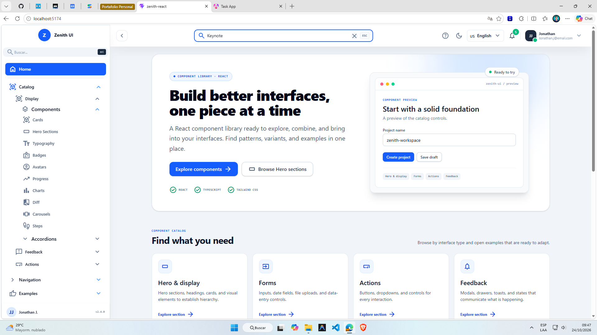
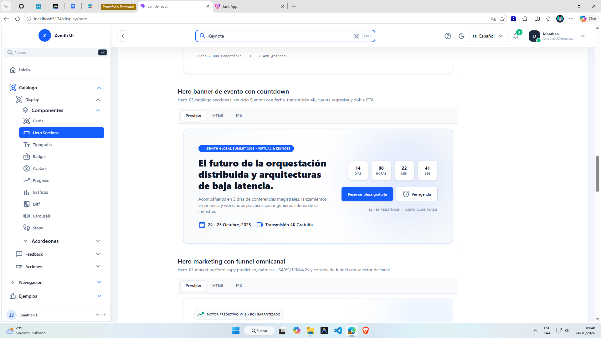
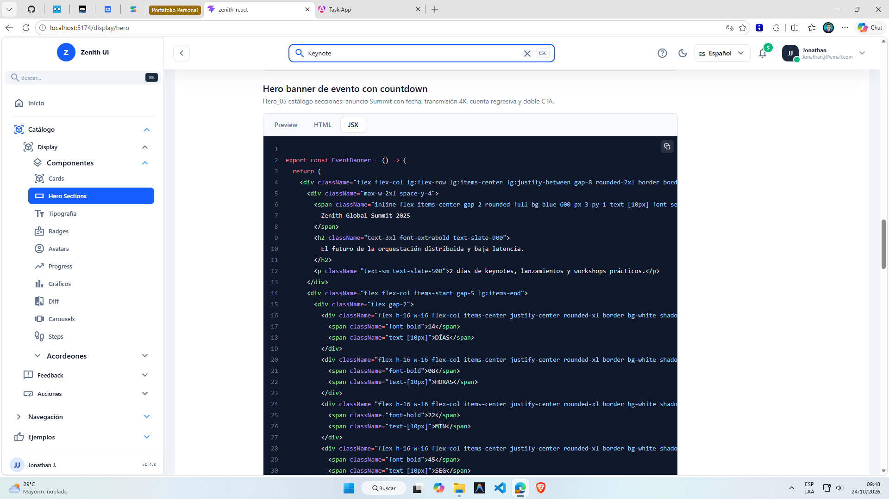
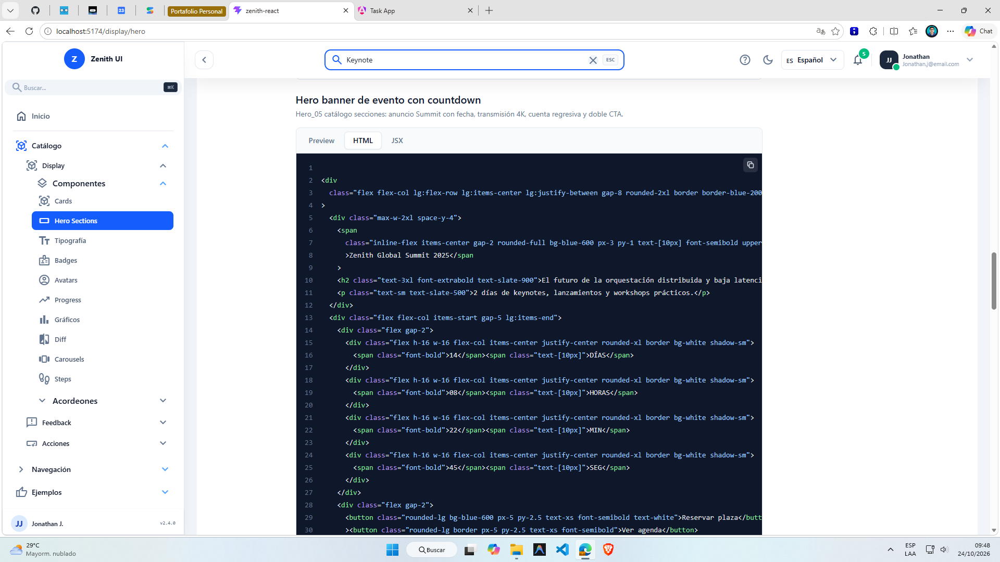
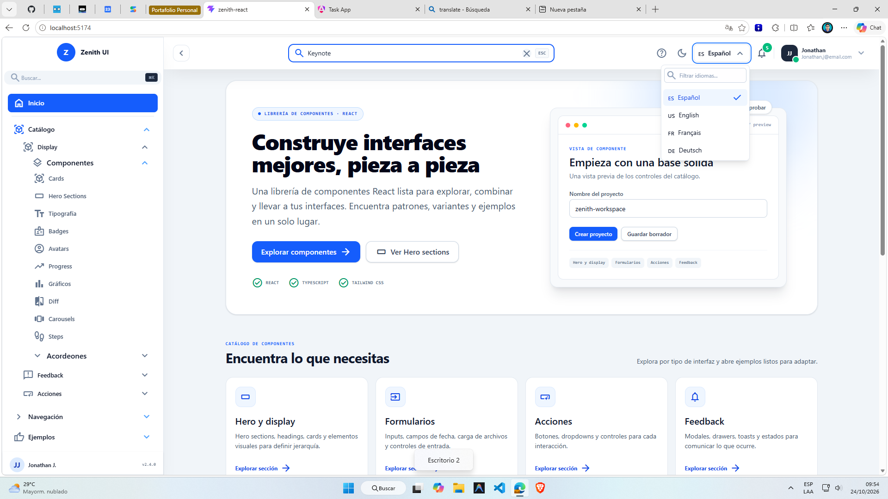

# Zenith UI

Catálogo interactivo de componentes e interfaces de ejemplo creado con React, TypeScript y Tailwind CSS. Cada componente documentado incluye una vista previa y, cuando está disponible, su implementación en HTML y JSX.

## Qué incluye

- **Catálogo de componentes:** formularios, botones, cards, headings, Hero sections, navegación, tablas, gráficos, modales, drawers, toasts, tooltips, accordions, skeletons, paginadores y más.
- **Documentación interactiva:** vista previa, código HTML y JSX, resaltado de sintaxis y copia al portapapeles.
- **Páginas de ejemplo:** una Landing page y flujos de autenticación para ver los componentes en contexto.
- **Tema claro y oscuro:** selector global con preferencia guardada en el navegador.
- **Cuatro idiomas:** español, inglés, francés y alemán; la selección se conserva entre visitas.
- **Diseño adaptable:** catálogo y ejemplos preparados para distintos tamaños de pantalla.

La aplicación funciona como catálogo frontend con ejemplos y datos de muestra; no requiere una API para explorar sus componentes.

## Tecnologías

- React 19 y TypeScript
- Vite 8
- Tailwind CSS 4
- React Router
- Recharts para gráficos
- Tiptap para el editor de texto enriquecido
- Shiki para resaltar el código de ejemplo
- Material Symbols para iconos

## Capturas de pantalla

La aplicación combina un catálogo para explorar componentes, documentación con código listo para consultar y páginas completas que muestran cómo se pueden usar las piezas juntas.

### Home del catálogo

La Home presenta las áreas disponibles y ofrece accesos directos a los ejemplos de Landing y Authentication. Desde el menú lateral se puede seguir explorando el resto del catálogo.



### Componentes documentados

Cada página de documentación muestra el componente funcionando y permite cambiar entre la vista previa y sus implementaciones en HTML y JSX. Los bloques de código incluyen resaltado de sintaxis y una acción para copiarlos.



| Código JSX                                                   | Código HTML                                                    |
| ------------------------------------------------------------ | -------------------------------------------------------------- |
|  |  |

### Ejemplos de interfaces

Las páginas de ejemplo reúnen varios componentes en una interfaz completa. La Landing incluye secciones de producto, contenido y llamadas a la acción. La captura de Authentication muestra el inicio de sesión; el flujo también incluye páginas de registro y recuperación.


También hay composiciones de interfaz moderna con elementos superpuestos y paneles laterales, además de ejemplos de visualización de datos.


La página de gráficos reúne visualizaciones de barras, líneas y anillos para mostrar distintas formas de presentar métricas.


### Idiomas

El selector permite cambiar entre español, inglés, francés y alemán. La interfaz actualiza sus textos sin recargar la página y recuerda el idioma elegido.



## Empezar en local

### Requisitos

- Node.js 20.19 o posterior, o 22.12 o posterior
- npm

### Instalar y ejecutar

```bash
cd zenith-react
npm ci
npm run dev
```

Abre [http://localhost:5173](http://localhost:5173).

## Comandos

Ejecuta estos comandos desde `zenith-react/`:

| Comando           | Descripción                                                           |
| ----------------- | --------------------------------------------------------------------- |
| `npm run dev`     | Inicia el servidor local de Vite.                                     |
| `npm start`       | Inicia Vite en `0.0.0.0`, accesible desde contenedores y la red local. |
| `npm run build`   | Comprueba TypeScript y genera la aplicación de producción en `dist/`. |
| `npm run preview` | Sirve localmente la compilación de producción.                        |
| `npm run lint`    | Ejecuta ESLint.                                                       |

## Ejecutar con Docker

Desde la raíz del repositorio:

```bash
docker compose up --build -d
```

Abre [http://localhost:5174](http://localhost:5174). Para detener y retirar el contenedor:

```bash
docker compose down
```

## Rutas principales

| Ruta              | Contenido                    |
| ----------------- | ---------------------------- |
| `/`               | Home del catálogo.           |
| `/display/hero`   | Ejemplos de Hero sections.   |
| `/display/charts` | Gráficos y dashboards.       |
| `/auth/login`     | Ejemplo de inicio de sesión. |
| `/landing/home`   | Ejemplo de Landing page.     |

El resto de las áreas del catálogo se puede explorar desde el menú lateral.

## Estructura del proyecto

```text
zenith-ui/
├── docs/                      # Guías de internacionalización y temas
├── screenshots/               # Capturas para la documentación
├── docker-compose.yml         # Entorno local con Docker Compose
└── zenith-react/
    ├── public/                # Recursos estáticos
    └── src/
        ├── auth/              # Ejemplos de autenticación
        ├── features/          # Componentes, documentación y snippets por área
        ├── helper/            # Páginas de error y estados de ayuda
        ├── landing/           # Ejemplos de Landing page
        ├── pages/             # Home y páginas del catálogo
        ├── routes/            # Configuración de rutas
        └── shared/            # Proveedores, hooks, traducciones y UI compartida
```

## Guías para reutilizar los patrones

- [Internacionalización paso a paso](docs/i18n.md): diccionarios, contexto, selector de idioma, persistencia y validación.
- [Tema claro/oscuro paso a paso](docs/theming.md): proveedor React, persistencia, Tailwind CSS y adaptación de componentes.
